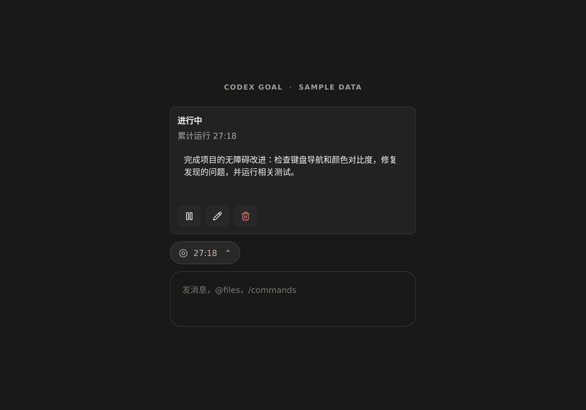
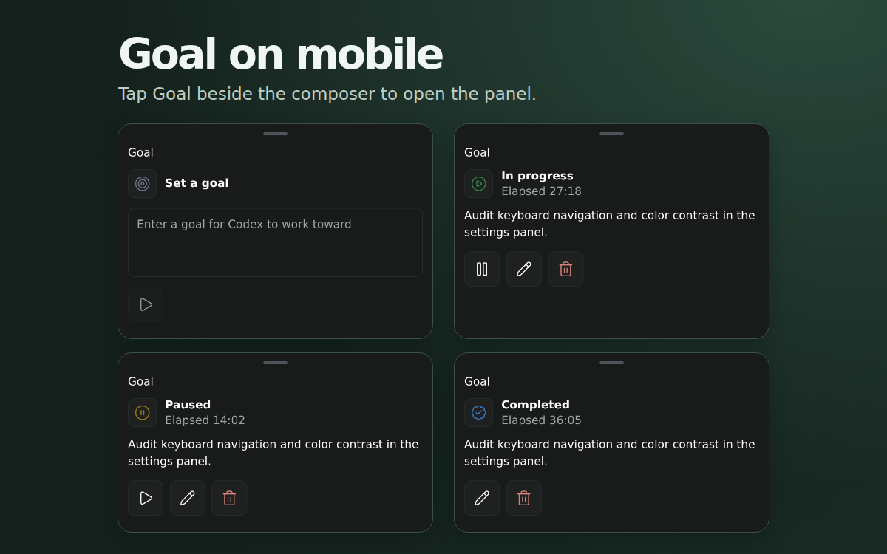

# Codex Goal for Paseo

[简体中文](README.zh-CN.md)

Codex Goal displays the current goal's elapsed time beside the composer in Codex sessions. Open the button to view its status and full objective, create or edit a goal, pause, resume, or clear it.

The interface follows Paseo's language setting: Simplified Chinese is available, and other languages use English. The Goal button uses distinct icons for active, paused, completed, blocked, usage-limited, and budget-limited goals. Once a blocker is resolved, you can resume from the Goal panel.

Elapsed time is based on the seconds recorded by Codex. While a goal is active and the session is running, the interface estimates the time since the last recorded update and reconciles it when Codex writes a new total. Pausing stops further goal progress, though the current turn may continue. Editing uses the native `/goal <objective>` command and attempts to activate the goal.

The plugin reads only the current session's goal. Each operation is initiated by the user and executed through Paseo's native `/goal` command.

## Keyboard shortcuts

On desktop and web, shortcuts apply while the Goal panel has focus. The defaults are **Enter** to start or save, **Shift+Enter** for a new line, **E** to edit, **P** to pause or resume, **Delete** to open clear confirmation, and **R** to retry after a read or sync failure. On wide layouts, Paseo closes the panel with **Esc**.

Under **Settings → Plugins → Codex Goal**, you can change the save, edit, pause/resume, clear, and retry bindings. Choose **Unassigned** to disable any of them and continue using the buttons. Settings are saved per Paseo host.

These desktop and mobile layout previews are rendered in a browser with sample data.

| Desktop | Mobile |
| --- | --- |
|  |  |

## Installation

Requires Paseo client and daemon 0.17.4 or later, a version of Codex that supports `/goal` (Paseo's minimum is Codex CLI 0.128.0), and a plugin runtime with `node:sqlite` (Node.js 22.13 or later).

To install directly from GitHub, run these commands on the machine running the Paseo daemon:

```sh
paseo plugin install git:Fu021/paseo-codex-goal-ui
paseo plugin ls
```

This requires Paseo plugins to be enabled and trusted, and the daemon must be able to access GitHub and the npm registry.

For local development, install dependencies and run the checks in this directory:

```sh
npm ci --ignore-scripts
npm run typecheck
npm test
```

GitHub Actions runs type checking and regression tests on Node.js 22 and 24 for pushes to `main` and pull requests.

If you trust this plugin and have enabled plugins under **Settings → Plugins** in Paseo, run the following commands in the same directory:

```sh
paseo plugin install "$PWD"
paseo plugin ls
```

Return to any Codex session and find **Goal** in the plugin button area beside the composer. When using a remote host, both the plugin and Codex data must be on that host.

The plugin queries Codex's local SQLite database in read-only mode. It uses the Codex data directory by default and supports `CODEX_HOME`, `CODEX_SQLITE_HOME`, and the top-level `sqlite_home` setting in the user's `config.toml`. If a launch script sets a different data directory for an individual session, point Paseo's Codex Provider environment variables to the same directory.
