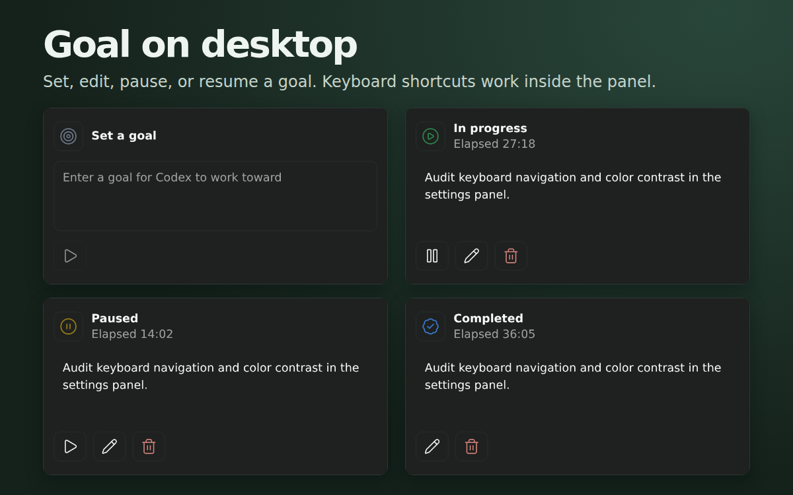
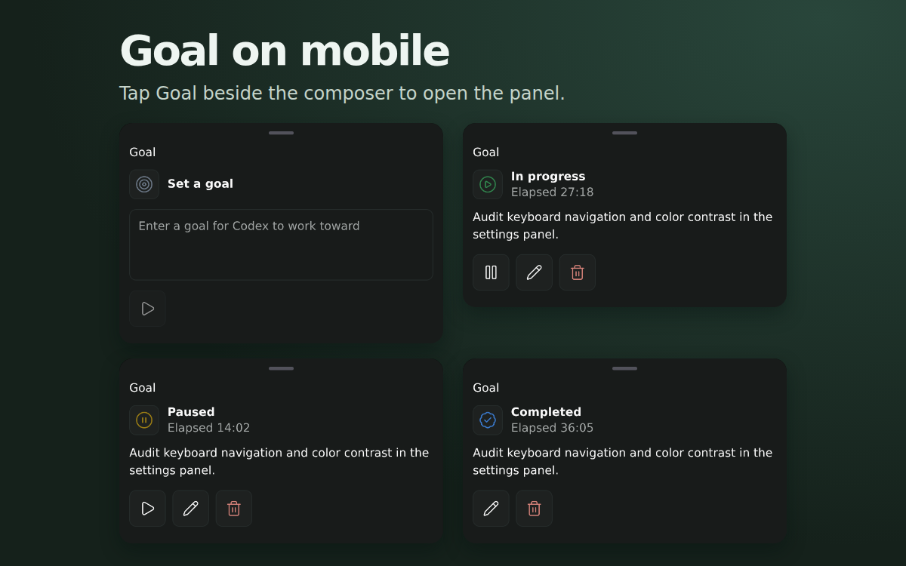
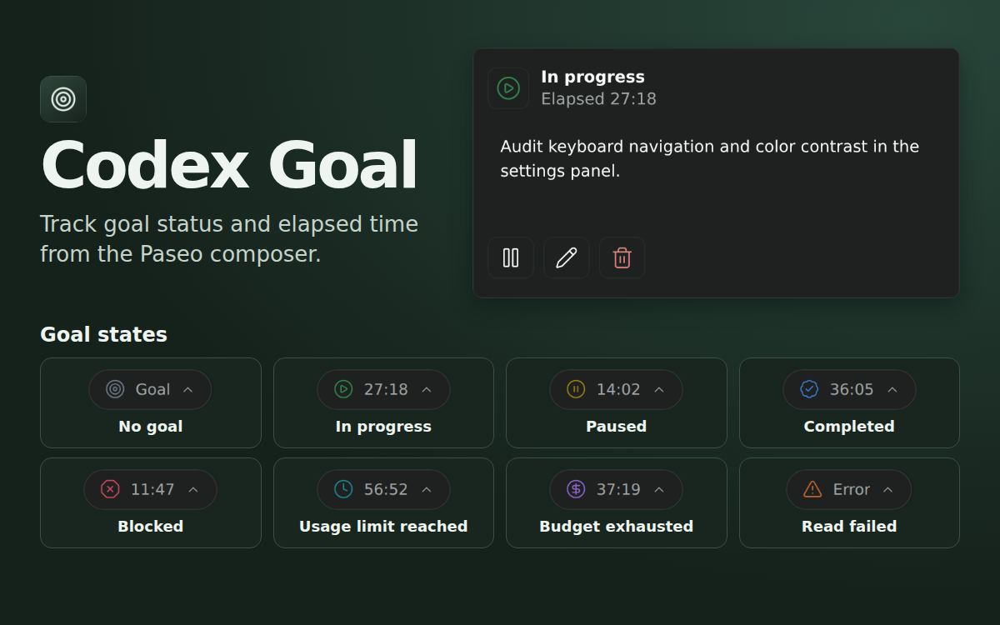

# Codex Goal for Paseo

[English](README.md)

在 Codex 会话的输入框旁显示 Goal 的累计运行时间。点开按钮可查看状态和完整目标、创建或编辑目标、暂停、继续和清除。

界面跟随 Paseo 的语言设置，支持简体中文，其他语言使用英文。Goal 按钮用八种图标区分状态，包括未设置目标和读取失败。桌面浮层和手机底部面板使用相同的状态配色。排除阻碍后，可以从 Goal 面板继续。

累计时间以 Codex 已记录的秒数为准。Goal 活跃且会话正在运行时，界面会估算最近一次目标更新后的本轮耗时，并在 Codex 写入新的累计值时校准。暂停停止目标的后续推进，当前一轮仍可能继续。编辑使用原生 `/goal <目标>`，会尝试激活目标。

插件只读取当前会话的目标记录。每次操作均由用户发起，通过 Paseo 原生 `/goal` 执行。

## 快捷键

在桌面端和网页版，快捷键仅在 Goal 面板拥有焦点时生效。默认按 **Enter** 开始或保存，**Shift+Enter** 换行，**E** 编辑，**P** 暂停或继续，**Delete** 打开清除确认，**R** 在读取或同步失败时重试。在宽屏布局中，可按 **Esc** 关闭 Paseo 浮层。

在 **设置 → 插件 → Codex Goal** 中，保存键仍在下拉菜单中选择。要更改编辑、暂停或继续、清除确认或重试键，点当前键位后输入一个字母，或选择 **Delete**。选择「未设置」可停用快捷键。设置按 Paseo 主机保存。

以下截图使用示例数据，展示桌面宽度和手机宽度下的 Paseo Goal 面板。

| 桌面 | 手机 |
| --- | --- |
|  |  |



## 安装

需要 Paseo 客户端和 daemon 0.16.0 或更新版本、支持 `/goal` 的 Codex（Paseo 的最低版本要求为 Codex CLI 0.128.0），以及提供 `node:sqlite` 的插件运行时（Node.js 22.13+）。

从 [Paseo 插件市场](https://paseo.sh/zh-CN/plugins/fu021/codex-goal)安装已审核的版本。使用命令行时，请在运行 Paseo daemon 的机器上执行以下命令。

```sh
paseo plugin install fu021/codex-goal
paseo plugin ls
```

请在 **设置 → 插件** 中启用插件，并确保 daemon 能访问 npm 注册表。若要直接从 npm 安装，可以运行 `paseo plugin install npm:codex-goal`。市场安装使用 Paseo 已审核的版本，直接从 npm 安装时可以用 `npm:codex-goal@<版本号>` 指定版本。

### 从 Git 版迁移

如果之前从旧市场条目 `fu021/codex-goal-ui` 或直接从 Git 安装过，请先运行 `paseo plugin ls` 确认已安装的插件 ID。记下自定义快捷键，用 `paseo plugin remove <已安装的 ID>` 卸载 Git 版，再按上面的命令安装 `fu021/codex-goal`。之后可在 **设置 → 插件 → Codex Goal** 中恢复快捷键。目标记录由 Codex 单独保存，迁移后仍可读取。

回到任意 Codex 会话，在输入框的插件按钮区找到 **Goal**。使用远程主机时，插件和 Codex 数据都要位于该主机。

插件以只读方式查询 Codex 的本地 SQLite。默认使用 Codex 数据目录，支持 `CODEX_HOME`、`CODEX_SQLITE_HOME` 和用户 `config.toml` 顶层的 `sqlite_home`。如果启动脚本为单个会话另设数据目录，请让 Paseo 的 Codex Provider 环境变量指向同一目录。

## 开发

本地开发时，在此目录安装依赖并运行检查。

```sh
npm ci --ignore-scripts
npm run typecheck
npm test
```

GitHub Actions 会在推送到 `main` 和提交 PR 时，用 Node.js 22 和 24 运行类型检查和回归测试。

如果你信任此插件，并且已在 Paseo 的 **设置 → 插件** 启用插件，在同一目录执行以下命令。

```sh
paseo plugin install "$PWD"
paseo plugin ls
```

## 发布

新版本通过 [npm 上的 codex-goal](https://www.npmjs.com/package/codex-goal) 发布。GitHub 托管源码，并在 `main` 上运行 CI。

暂存发布需要 Node.js 22.14 或更新版本、npm 11.15 或更新版本，以及有权发布此包并已启用双重验证的 npm 账户。

1. 更新 `package.json` 和 `npm-shrinkwrap.json` 中的版本号。运行开发检查，再用 `npm pack --dry-run --ignore-scripts` 确认双语介绍和全部截图都在包内。将发布提交推送到 `main`，等待 CI 通过。
2. 运行 `npm stage publish` 暂存包，用 `npm stage list codex-goal` 查找暂存 ID，再执行 `npm stage approve <暂存 ID>` 并完成 npm 双重验证，正式发布。
3. 在测试 daemon 上用 `paseo plugin install npm:codex-goal@<版本号>` 安装该版本，确认插件正在运行并试用 Goal 面板。
4. 查看 Paseo 注册表为 `fu021/codex-goal` 自动创建的更新 PR。Paseo 审核并合并后，市场才会提供新版本。

[npm 暂存发布](https://docs.npmjs.com/staged-publishing/) · [Paseo 插件发布](https://paseo.sh/docs/plugins/publishing)
